# I. Khái niệm

## 1. Authentication (Xác thực)

Authentication là quá trình hệ thống kiểm tra danh tính của người dùng, để xác định người dùng là ai. Trong ứng dụng web, hình thức xác thực phổ biến nhất là sử dụng thông tin đăng nhập. Quá trình xác thực bằng mật khẩu thường diễn ra như sau:

1. Người dùng nhập email và mật khẩu.
2. Client gửi thông tin đăng nhập đến backend qua HTTPS.
3. Backend tìm tài khoản tương ứng trong cơ sở dữ liệu.
4. Backend so sánh mật khẩu được cung cấp với password hash đã lưu.
5. Nếu thông tin hợp lệ, hệ thống xác thực thành công và tạo thông tin xác thực cho các request tiếp theo.
6. Nếu thông tin không hợp lệ, hệ thống từ chối đăng nhập.

## 2. Authorization (Phân quyền)

Authorization là quá trình xác định một chủ thể đã được xác thực có được phép thực hiện một hành động cụ thể trên một tài nguyên hay không. Ví dụ trong 1 công ty:

- Kế toán có thể xem lương của tất cả nhân viên

- HR thì có thể xem các CV gửi về ứng tuyển

- Tổng giám đốc thì có thể xem cả 2

Authorization ngăn chặn việc chủ thể truy cập vào những tài nguyên mà mình không được phép.

## 3. Phân biệt Authentication và Authorization

| Tiêu chí | Authentication | Authorization |
|---|---|---|
| Mục đích | Xác minh danh tính | Kiểm soát hành động |
| Đầu vào thường gặp | Mật khẩu, token, OTP | Danh tính, vai trò, quyền, tài nguyên |
| Thời điểm | Trước khi xác định quyền truy cập | Sau khi xác định danh tính hoặc trong quá trình xử lý request |
| Ví dụ | Đăng nhập thành công | Chỉ admin được xóa tài khoản |
| Mã HTTP thường gặp | `401 Unauthorized` | `403 Forbidden` |

Hai khái niệm có quan hệ chặt chẽ nhưng không thay thế cho nhau. Một người dùng đăng nhập thành công không có nghĩa là người đó được phép truy cập tất cả chức năng trong hệ thống.

# II. Phân biệt cơ chế xác thực

## 1. Session-base

### 1.1 Khái niệm 

Session-based Authentication là cơ chế xác thực trong đó server tạo và quản lý phiên đăng nhập của người dùng. Server lưu trạng thái phiên trong bộ nhớ, database hoặc hệ thống lưu trữ như Redis.

Sau khi đăng nhập thành công, server cấp cho client một session ID. Session ID thường được gửi qua cookie và được trình duyệt tự động gửi lại trong các request tiếp theo.

### 1.2 Flow hoạt động

Client gửi thông tin đăng nhập -> Server kiểm tra, tạo một Session lưu trong bộ nhớ (Memory/DB) -> Server trả về session_id qua Cookie -> Các request sau Client tự đính kèm Cookie -> Server đối chiếu session_id với DB để xác định user.

### 1.3 Cookie

Cookie là dữ liệu nhỏ được trình duyệt lưu trữ và gửi kèm request theo các quy tắc về domain, path, thời hạn và thuộc tính bảo mật.
Một số thuộc tính quan trọng:
- HttpOnly: ngăn JavaScript phía client đọc cookie.
- Secure: chỉ gửi cookie qua HTTPS.
- SameSite: kiểm soát việc gửi cookie trong một số ngữ cảnh cross-site, hỗ trợ giảm nguy cơ CSRF.
- Path và Domain: giới hạn phạm vi cookie được gửi.

### 1.4 Ưu điểm và hạn chế

#### Ưu điểm
- Server có thể thu hồi phiên đăng nhập bằng cách xóa hoặc vô hiệu hóa session.
- Dễ quản lý phiên và trạng thái đăng nhập.
- Phù hợp với các ứng dụng web truyền thống sử dụng cookie.

#### Hạn chế
- Server phải quản lý kho session.
- Khi chạy nhiều instance, cần cơ chế chia sẻ session hoặc lưu trữ tập trung.
- Cookie tự động được trình duyệt gửi đi có thể tạo rủi ro CSRF nếu cấu hình bảo vệ không phù hợp.

## 2. Token-based Authentication

### 2.1 Khái niệm 

Token-based Authentication là cơ chế xác thực trong đó server cấp token sau khi người dùng đăng nhập thành công. Client sử dụng token này để chứng minh trạng thái xác thực khi gửi request tiếp theo.
Với REST API, một cách triển khai phổ biến là gửi access token trong HTTP header. Server kiểm tra token trước khi xử lý request.

### 2.2 Quy trình hoạt động

1. Client gửi thông tin đăng nhập.
2. Server xác minh thông tin.
3. Server cấp token.
4. Client lưu trữ token theo chính sách bảo mật của ứng dụng.
5. Client gửi token trong các request cần xác thực.
6. Server xác minh token và xác định danh tính tương ứng.
7. Middleware phân quyền quyết định request có được phép tiếp tục hay không.

## 3. So sánh Session-based Authentication và Token-based Authentication

### 3.1. So sánh tổng quan

| Tiêu chí | Session-based Authentication | Token-based Authentication |
|---|---|---|
| **Khái niệm** | Server tạo và quản lý phiên đăng nhập của người dùng. | Server cấp token để client sử dụng khi gửi các request cần xác thực. |
| **Nơi lưu trạng thái xác thực** | Server lưu session; client giữ session ID. | Thường không cần lưu trạng thái xác thực của access token trên server nếu sử dụng token tự xác minh như JWT. |
| **Dữ liệu gửi từ client** | Thường gửi session ID thông qua cookie. | Thường gửi access token qua HTTP header `Authorization`. |
| **Cách xác thực request** | Server sử dụng session ID để tra cứu session và xác định người dùng. | Server xác minh token, chẳng hạn kiểm tra chữ ký, thời hạn và các thông tin cần thiết. |
| **Trạng thái (State)** | Thường là stateful vì server quản lý trạng thái phiên. | Có thể stateless nếu token tự xác minh và server không cần tra cứu trạng thái lưu trữ cho mỗi request. |
| **Thu hồi đăng nhập** | Có thể vô hiệu hóa session ngay bằng cách xóa hoặc đánh dấu session không hợp lệ. | Với JWT access token tự xác minh, việc thu hồi ngay thường phức tạp hơn; có thể dùng thời hạn ngắn, denylist hoặc cơ chế kiểm tra trạng thái bổ sung. |
| **Khả năng mở rộng** | Khi có nhiều server, thường cần kho session dùng chung hoặc cơ chế đồng bộ session. | Token tự xác minh có thể được kiểm tra trên nhiều server mà không cần chia sẻ kho session cho mỗi lần xác thực. |
| **Lưu trữ phía client** | Thường lưu session ID trong cookie. | Có thể lưu token trong cookie, bộ nhớ của ứng dụng hoặc các cơ chế lưu trữ khác tùy nền tảng và yêu cầu bảo mật. |
| **Bảo mật cookie** | Cần cấu hình `HttpOnly`, `Secure`, `SameSite` phù hợp. | Nếu token được lưu trong cookie, cũng cần cấu hình cookie an toàn và cân nhắc CSRF. |
| **Nguy cơ XSS** | JavaScript không thể đọc cookie có `HttpOnly`, nhưng XSS vẫn có thể thực hiện hành động thay mặt người dùng. | Token lưu trong `localStorage` có thể bị JavaScript độc hại đọc nếu xảy ra XSS. Token trong cookie `HttpOnly` giảm nguy cơ bị đọc trực tiếp nhưng không loại bỏ mọi rủi ro XSS. |
| **Nguy cơ CSRF** | Có thể gặp CSRF vì trình duyệt tự động gửi cookie. | Thường giảm nguy cơ CSRF khi token được gửi trong header do ứng dụng chủ động thiết lập; tuy nhiên, vẫn cần xem xét cách lưu trữ và gửi token thực tế. |
| **Độ phức tạp triển khai** | Tương đối đơn giản đối với ứng dụng web truyền thống. | Có thể đơn giản với hệ thống nhỏ, nhưng cần thiết kế cẩn thận về thời hạn token, refresh token và thu hồi token. |
| **Trường hợp phù hợp** | Website truyền thống, hệ thống quản trị nội bộ, ứng dụng cần quản lý phiên và đăng xuất tức thời. | REST API, ứng dụng mobile, SPA, hệ thống nhiều dịch vụ hoặc các ứng dụng cần xác thực qua API. |

### 3.2. Khi nào nên sử dụng Session-based Authentication?

Session-based Authentication phù hợp trong các trường hợp sau:

- **Website truyền thống:** Ứng dụng web sử dụng cookie và server quản lý phiên đăng nhập.
- **Hệ thống quản trị nội bộ:** Ví dụ website quản lý nhân viên, quản lý kho hoặc quản lý nhà hàng.
- **Ứng dụng cần thu hồi phiên nhanh chóng:** Quản trị viên có thể vô hiệu hóa session của người dùng khi tài khoản bị khóa hoặc khi người dùng đăng xuất.
- **Hệ thống cần quản lý trạng thái đăng nhập tập trung:** Server có thể theo dõi các phiên đang hoạt động, thời gian hết hạn và trạng thái của từng phiên.

**Ví dụ:** Một website bán hàng sử dụng session để lưu trạng thái đăng nhập. Khi người dùng đăng xuất, server xóa session tương ứng. Những request tiếp theo sử dụng session ID cũ sẽ không còn được xác thực.

**Lưu ý:** Nếu ứng dụng có nhiều server, cần sử dụng kho session dùng chung như Redis hoặc database, hoặc một cơ chế tương đương để các server có thể xác thực phiên nhất quán.

### 3.3. Khi nào nên sử dụng Token-based Authentication?

Token-based Authentication phù hợp trong các trường hợp sau:

- **REST API:** Client gửi token qua HTTP header để xác thực khi gọi API.
- **Ứng dụng mobile:** Ứng dụng Android hoặc iOS có thể sử dụng access token để truy cập API.
- **Single Page Application (SPA):** Các ứng dụng React, Vue hoặc Angular có thể sử dụng token để gọi backend API.
- **Hệ thống nhiều dịch vụ:** Nhiều dịch vụ có thể xác minh token theo cùng một chính sách xác thực mà không nhất thiết phải tra cứu một kho session chung cho mỗi request.
- **Hệ thống cần tích hợp xác thực:** Token có thể được sử dụng trong các hệ thống API hoặc trong những kiến trúc xác thực phân tán phù hợp.

**Ví dụ:** Một ứng dụng React gọi API Node.js. Sau khi đăng nhập, server cấp access token. Client gửi token trong header `Authorization` của những request cần xác thực.

Ví dụ header:

```http
Authorization: Bearer <access_token>
```

Backend sử dụng middleware để xác minh token trước khi cho phép request tiếp tục.

**Lưu ý:** Không phải mọi token đều stateless. Ví dụ, opaque token thường cần server tra cứu thông tin hoặc gọi dịch vụ xác thực. JWT cũng có thể cần kiểm tra trạng thái lưu trữ nếu hệ thống hỗ trợ thu hồi token sớm.

# III. JWT Token

## 1. Khái niệm

JWT là một tiêu chuẩn mở (RFC 7519) quy định cách truyền thông tin an toàn giữa các bên dưới dạng đối tượng JSON. Thông tin này được xác thực và đáng tin cậy nhờ vào chữ ký số.

## 2. Cấu trúc

Gồm 3 phần ngăn cách bởi dấu chấm . `(Header.Payload.Signature)`

- Header: Chứa loại token (JWT) và thuật toán mã hóa (VD: HS256, RS256).
- Payload: Chứa các claims (thông tin) về user (VD: id, role, email) và thời gian hết hạn (exp). Lưu ý: Phần này chỉ encode Base64, không bị mã hóa, ai cũng có thể đọc được. Vì vậy không lưu mật khẩu hay thông tin nhạy cảm ở đây
- Signature: Chữ ký được tạo ra bằng cách lấy Header + Payload băm cùng với một chuỗi bí mật (Secret Key) trên server. Dùng để đảm bảo token không bị giả mạo.

## 3. Lợi ích
Stateless (giảm tải DB), gọn nhẹ (có thể gửi qua URL, POST, Header), dễ dàng áp dụng cho kiến trúc phân tán (Microservices).

## 4. Hạn chế
**Khó thu hồi (Revoke):** Khi token đã cấp ra, nó sẽ sống cho đến khi hết hạn (exp). Nếu user bị hack token, hacker có thể dùng nó cho đến khi hết hạn (Trừ khi áp dụng thêm blacklist).
**Kích thước:** JWT thường dài hơn session_id, tốn băng thông hơn một chút.

## 5. Access Token và Refresh Token

### 5.1 Access Token

**Khái niệm:** Access Token là thông tin xác thực do server cấp sau khi người dùng đăng nhập thành công. Client sử dụng Access Token để chứng minh danh tính khi gửi các request đến những API yêu cầu xác thực.
**Đặc điểm:**
- Thường có thời hạn ngắn, ví dụ 5–15 phút tùy chính sách bảo mật.
- Được sử dụng để truy cập các API yêu cầu xác thực.
- Nếu bị đánh cắp, token có thể bị kẻ tấn công sử dụng cho đến khi hết hạn hoặc bị vô hiệu hóa theo cơ chế của hệ thống.

### 5.2 Refresh Token

**Khái niệm:** Refresh Token là thông tin xác thực được server cấp để client yêu cầu cấp Access Token mới khi Access Token hết hạn, mà không cần người dùng đăng nhập lại mỗi lần.

**Đặc điểm:**
- Thường có thời hạn dài hơn Access Token.
- Không nên gửi kèm mọi API request; chỉ gửi đến endpoint làm mới token hoặc các endpoint được thiết kế riêng để xử lý Refresh Token.
- Cần có cơ chế bảo vệ, thu hồi và quản lý vòng đời.
- Có thể được lưu trong cookie HttpOnly, Secure với cấu hình SameSite phù hợp đối với ứng dụng web, hoặc trong nơi lưu trữ an toàn tương ứng với nền tảng.
- Nếu bị đánh cắp, Refresh Token có thể cho phép kẻ tấn công liên tục xin cấp Access Token mới cho đến khi token hết hạn hoặc bị vô hiệu hóa.

# IV. Password Hashing

## 1. Tại sao không lưu Plain Text
Nếu hacker chiếm được Database, họ sẽ thấy toàn bộ mật khẩu của người dùng, dẫn đến hậu quả nghiêm trọng (đặc biệt khi người dùng hay dùng chung mật khẩu cho nhiều dịch vụ).

## 2. Tại sao không dùng MD5/SHA
Các thuật toán này được thiết kế để tính toán cực nhanh (dùng cho check tính toàn vẹn file). Hacker có thể dùng Brute-force (thử hàng tỷ mật khẩu 1 giây nhờ GPU) hoặc dùng Rainbow Tables (bảng băm mật khẩu được tạo sẵn) để tra ngược ra mật khẩu gốc trong vài phút.

## 3. Dùng bcrypt/argon2
**Salt:** tự động sinh ra một chuỗi ngẫu nhiên gắn vào mật khẩu trước khi băm $\rightarrow$ 2 user có cùng mật khẩu 123456 sẽ ra 2 chuỗi hash hoàn toàn khác nhau (vô hiệu hóa Rainbow Tables).
**Cost Factor (Độ trễ):** Chủ động làm chậm quá trình băm (VD: mất 0.5s để băm 1 mật khẩu). Người dùng chờ 0.5s lúc đăng nhập không sao, nhưng hacker muốn băm hàng tỷ mật khẩu sẽ mất hàng trăm năm (Vô hiệu hóa Brute-force).

# V Demo

## 1. Đăng ký user

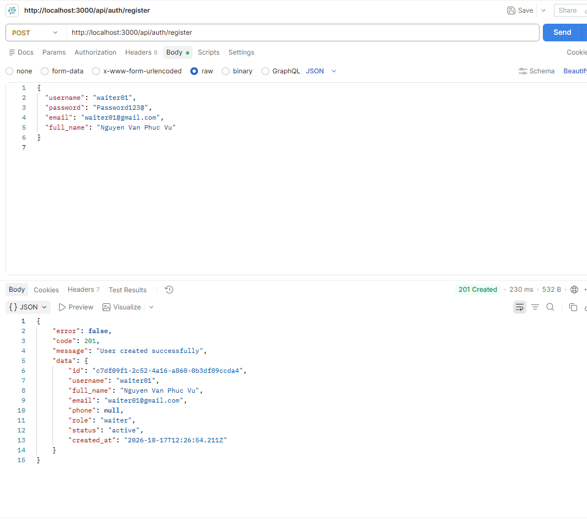

## 2. Đăng ký admin

Tạo 1 tài khoản user thường

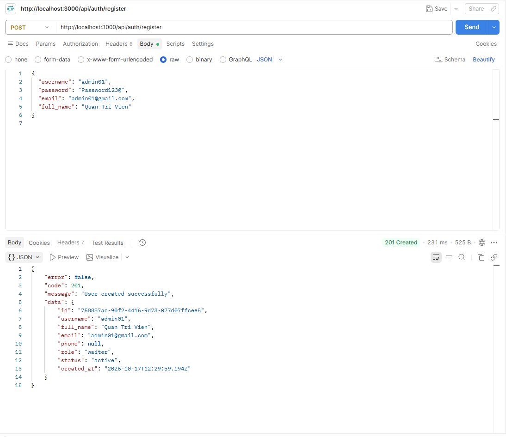

Sửa role tài khoản user thành admin

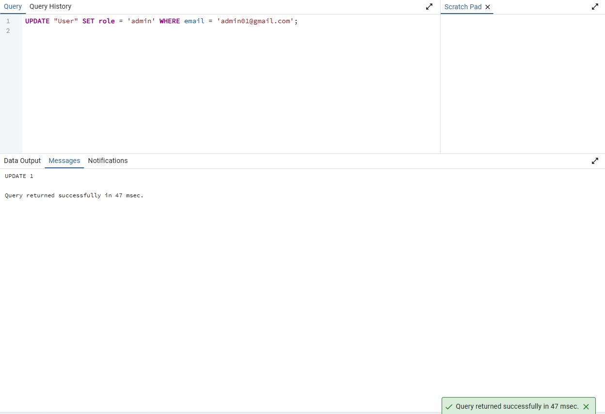

## 3. Đăng nhập

Account waiter

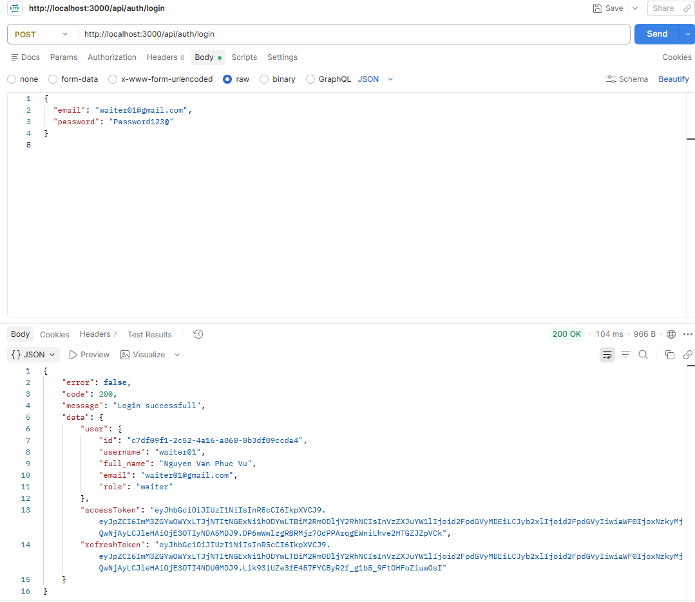

Account admin

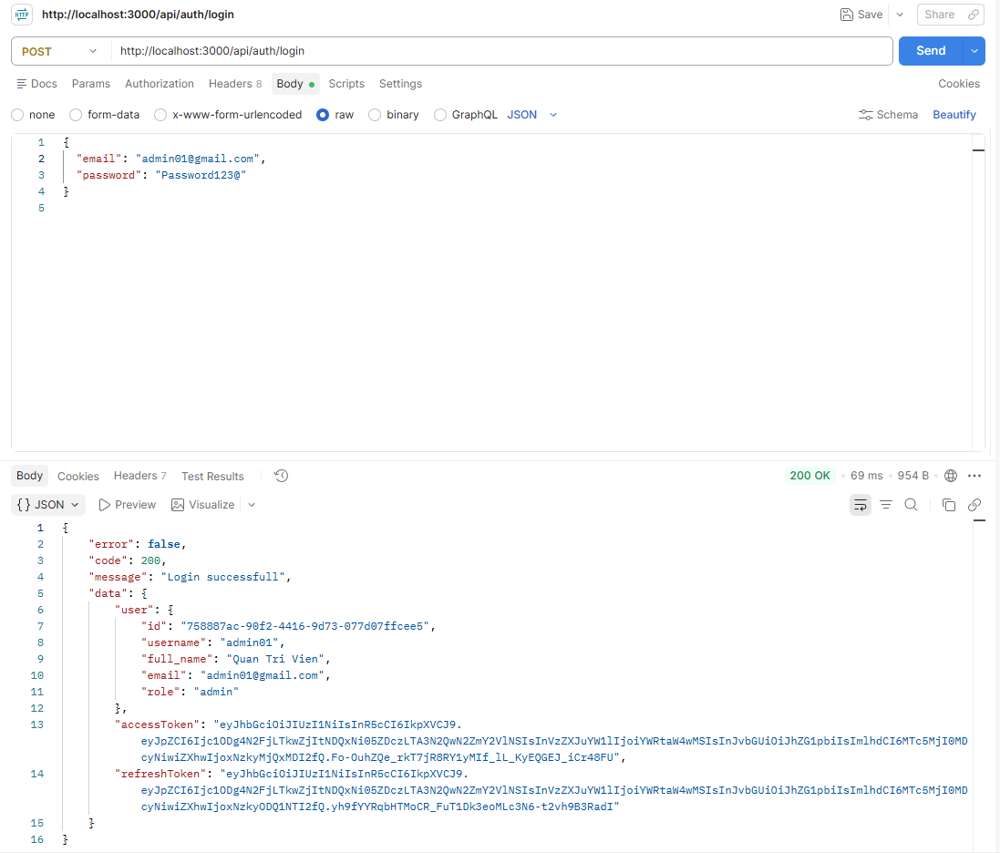

## 4. Test API

Khi không có token

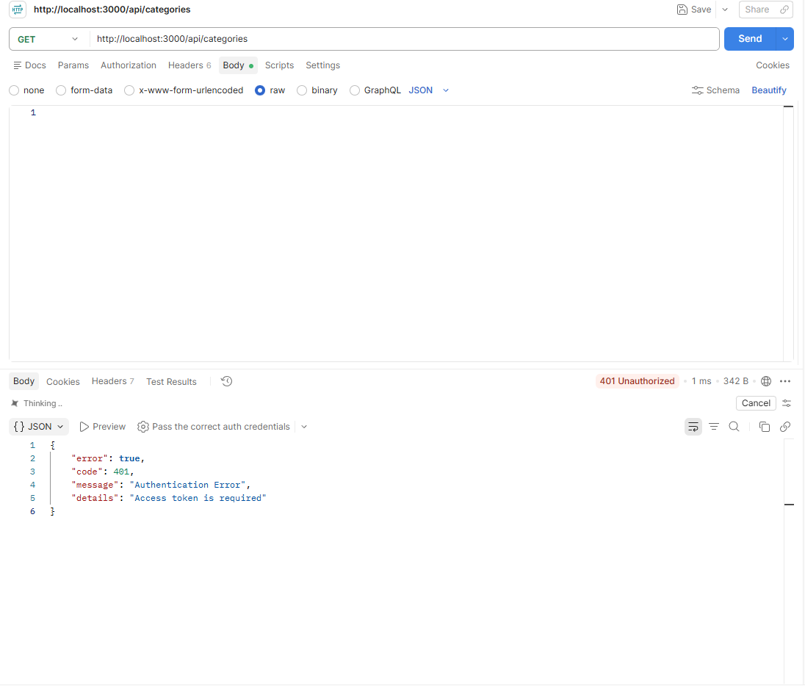

Khi có token

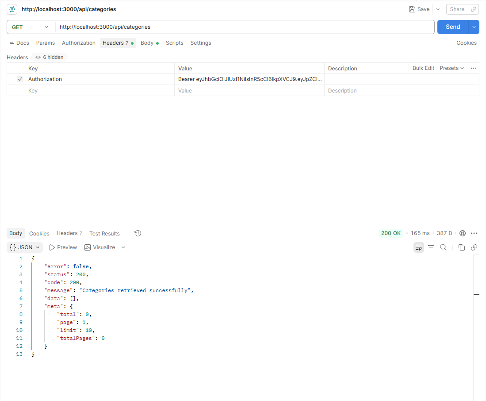

## 5. Test phân quyền

Waiter thử đổi role mình thành admin

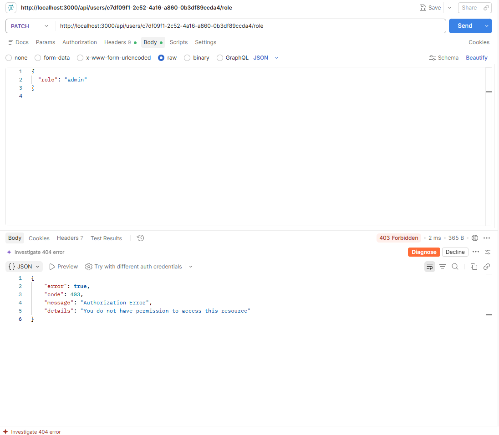

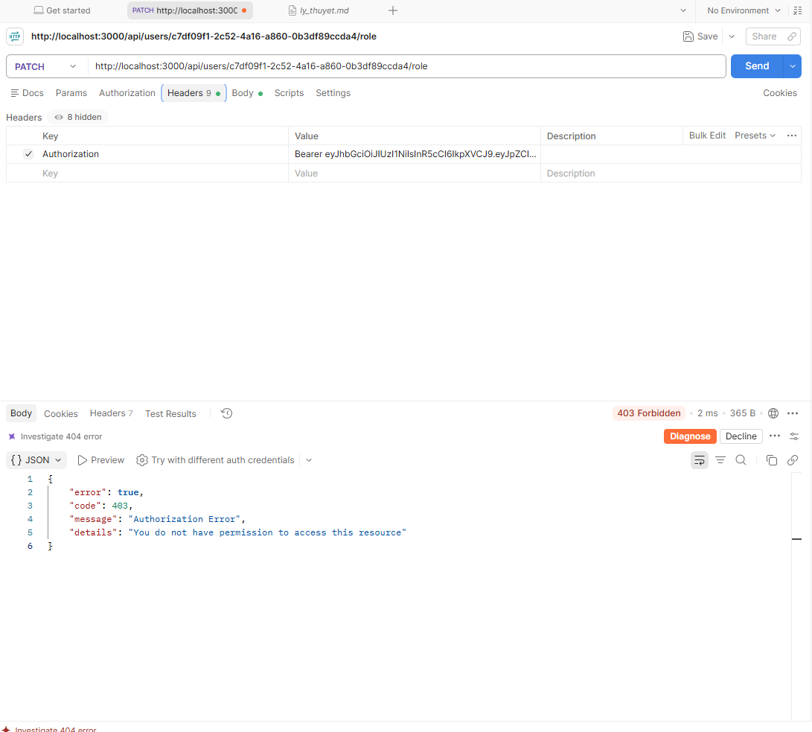

Admin cấp quyền 


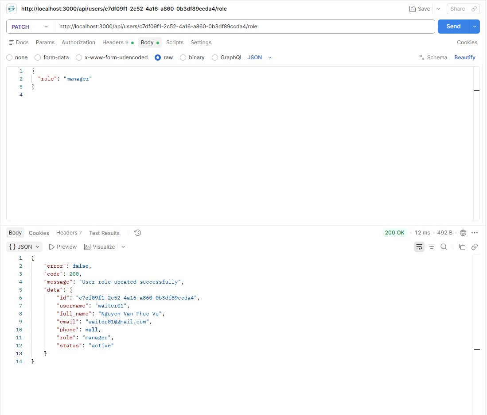

## 6. Test Refresh token


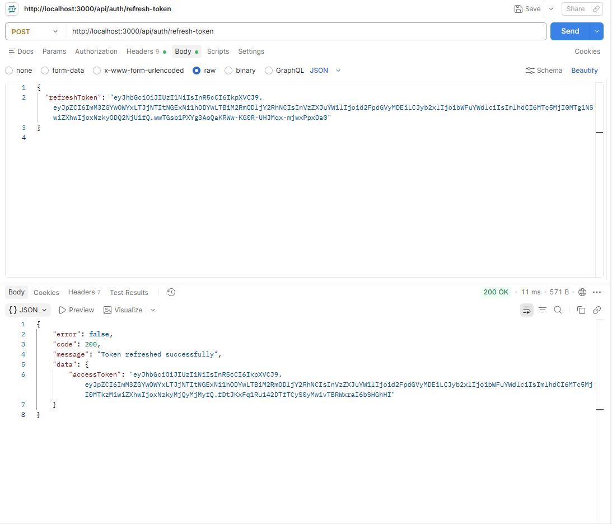