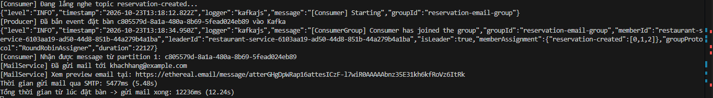
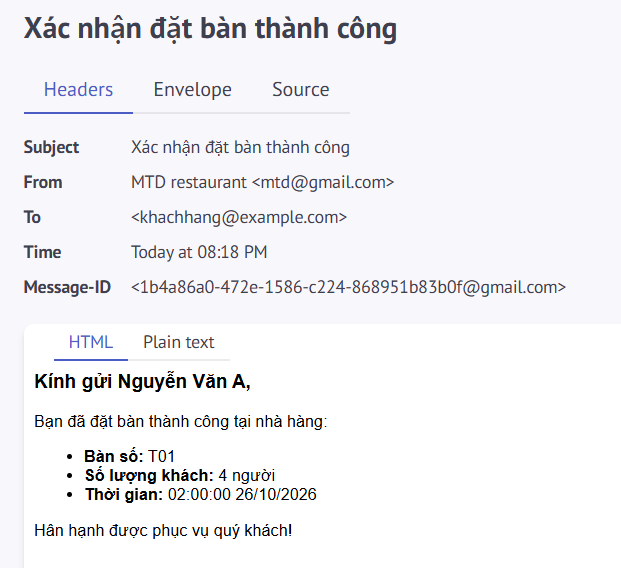

# I. Message Queue

## 1. Khái niệm

Message Queue (Hàng đợi tin nhắn) là một kiến trúc giao tiếp bất đồng bộ (asynchronous) giữa các dịch vụ (services) hoặc tiến trình (processes) trong hệ thống phần mềm. Nó hoạt động như một bộ đệm (buffer) lưu trữ các tin nhắn (messages) cho đến khi ứng dụng nhận (consumer) sẵn sàng xử lý chúng.

## 2. Lý do cần Message Queue

Giả sử hệ thống có chức năng Khách hàng đặt bàn trực tuyến (Reservation). Nếu không dùng MQ, khi khách hàng bấm "Đặt bàn", hệ thống phải làm tuần tự:

1. Lưu thông tin vào bảng Reservation (status: pending).

2. Gọi API bên thứ 3 để gửi tin nhắn SMS/Email thông báo đặt bàn thành công cho Customer.

3. Thông báo theo thời gian thực (real-time) đến màn hình của quản lý (Manager).

4. Ghi log vào hệ thống.

**Vấn đề xảy ra:** Việc gửi SMS/Email phụ thuộc vào mạng và bên thứ 3, có thể mất từ 3-5 giây. Khách hàng sẽ phải nhìn màn hình "loading" rất lâu, nếu gửi email lỗi, quá trình đặt bàn có thể bị fail oan.

**Giải pháp với MQ:**
API chỉ làm đúng việc lưu bản ghi vào bảng Reservation, sau đó "đẩy" một thông điệp "Có người đặt bàn" vào Message Queue và trả về kết quả "Thành công" ngay lập tức cho khách hàng. Các tác vụ gửi Email/SMS và thông báo sẽ được các Consumer lấy từ Queue ra và âm thầm xử lý dưới nền.

## 3. Sync (Đồng bộ) và Async (Bất đồng bộ) communication

### 3.1 Synchronous Communication - Giao tiếp đồng bộ

Khái niệm: Synchronous Communication là cách giao tiếp trong đó bên gửi thường chờ phản hồi hoặc kết quả từ bên nhận trước khi tiếp tục bước công việc phụ thuộc vào kết quả đó

Đặc điểm:

- Luồng xử lý dễ hiểu, dễ theo dõi
- Phù hợp khi cần kết quả ngay để thực hiện bước tiếp theo
- Bên gửi phải chờ phản hồi về mặt nghiệp vụ
- Nếu bên nhận phản hồi chậm, bên gửi có thể phải chờ lâu
- nếu phụ thuộc vào một service đang lỗi hoặc không phản hồi, request có thể thất bại hoặc hết thời gian chờ

### 3.2 Asynchronous Communication - Giao tiếp bất đồng bộ

Khái niệm: Asynchronous Communication là cách giao tiếp trong đó bên gửi có thể tiếp tục công việc mà không cần chờ bên nhận hoàn thành toàn bộ tác vụ. Kết quả hoặc trạng thái hoàn thành có thể được nhận sau thông qua callback, sự kiện, message queue hoặc một cơ chế khác.

Đặc điểm
- Các bên có thể hoạt động độc lập hơn.
- Có thể xử lý tác vụ nền và các công việc kéo dài.
- Hỗ trợ mở rộng hệ thống khi có nhiều công việc cần xử lý.
- Có thể giảm thời gian chờ của request chính.
- Đổi lại, hệ thống phức tạp hơn: cần quản lý lỗi, retry, thứ tự message, message trùng lặp và trạng thái xử lý.

## 4. Trường hợp nên sử dụng Message Queue

**Gọi trực tiếp (Sync):** Khi luồng nghiệp vụ bắt buộc phải có kết quả ngay lập tức để quyết định bước tiếp theo. Ví dụ: Cashier gọi API kiểm tra trạng thái bàn (Restaurant_Table.status) xem có trống không trước khi xếp khách.

**Dùng MQ (Async):** Đối với các tác vụ nặng (Heavy processing), các tác vụ gọi bên thứ 3 (Gửi Email/SMS, Cổng thanh toán), hoặc các chức năng không ảnh hưởng trực tiếp đến luồng chính của người dùng (Ghi log vào bảng Order_Status_History, đồng bộ dữ liệu).

# II. Các mô hình Message Queue

## 1. Point-to-Point (Queue Model)

**Cơ chế:** Producer đẩy message vào một Queue. Có thể có một hoặc nhiều Consumer cùng lắng nghe Queue đó (gọi là Competing Consumers), nhưng mỗi message chỉ được giao cho duy nhất 1 Consumer xử lý. Sau khi xử lý xong, message bị xóa khỏi Queue.

**Mục đích:** Chia tải công việc (Load Balancing / Task Distribution) giữa các worker.

## 2. Publish/Subscribe (Pub/Sub - Topic Model)

**Cơ chế:** Producer xuất bản (Publish) một message vào một Topic/Exchange. Nhiều Consumer đăng ký (Subscribe) nhận tin từ Topic đó thông qua các hàng đợi riêng của mình. Một message sẽ được nhân bản (broadcast) tới tất cả các Consumer đang đăng ký.

**Mục đích:** Thông báo sự kiện (Event Notification) cho nhiều dịch vụ độc lập cùng phản ứng.

## 3. So sánh giữa 2 mô hình

| Đặc điểm | Point-to-Point (Queue) | Publish/Subscribe (Topic/Fanout) | 
|:---------|:-----------------------|:---------------------------------| 
| Số lượng bên nhận / 1 message | Đúng 1 Consumer nhận và xử lý. | Tất cả Consumer đã subscribe đều nhận được bản sao. |
| Mối quan hệ | 1-1 (hoặc chia tải giữa các Worker cùng chức năng). | 1-N (phát tán cho nhiều dịch vụ khác chức năng). | 
| Use case điển hình | Gửi email xác nhận (nếu chạy 3 instance Email Worker để tăng tốc, mỗi email chỉ được gửi 1 lần, không được gửi trùng 3 lần). | Sự kiện User Đặt Hàng Thành Công cần báo đồng thời cho 3 dịch vụ khác nhau: Email Service (gửi mail), Inventory Service (trừ kho), và Analytics Service (cộng doanh thu). |

# III. Kafka và kiến trúc

## 1. Producer

Ứng dụng phát sinh và gửi message vào Kafka (là Backend API)

## 2. Broker 
Máy chủ Kafka chịu trách nhiệm nhận, lưu trữ message trên ổ đĩa và phục vụ dữ liệu cho Consumer

## 3. Topic
Luồng dữ liệu được đặt tên theo danh mục nghiệp vụ 

## 4. Partition (Phân vùng)

Mỗi Topic được chia thnafh một hoặc nhiều Partition để có thể phân tán dữ liệu trên nhiều máy chủ và cho phép nhiều Consumer xử lý song song

Dữ liệu trong mỗi Partition là một chuỗi log bất biến, chỉ ghi nối tiếp vào cuối (Append-only)

Cơ chế chọn Partition: Nếu Producer truyền kèm một key, Kafka sẽ băm `Hash(Key) % Số Partition`. Nhờ vậy mọi message có cùng Key luôn đi vào cùng 1 Partitiopn theo đúng thứ tự. Nếu không truyền Key, Kafka phân bố đều vào các Patition

## 5. Offset 

Là số thứ tự nguyên tăng dần (0,1,2,3,...) định danh duy nhất vị trí của từng message bên trong một Partition

Consumer dùng Offset như một dấu trang để đánh dấu xem mình đã đọc đến message thứ mấy

## 6. Consumer & Consumer Group:

Consumer: Tiến trình kéo (pull) message từ Topic về để xử lý (ví dụ: Worker gửi email).

Consumer Group: Một nhóm các Consumer cùng làm chung một nhiệm vụ. Quy tắc cốt lõi của Kafka: Bên trong 1 Consumer Group, 1 Partition chỉ được giao cho tối đa 1 Consumer đọc tại một thời điểm. (Do đó, số lượng Consumer tối đa chạy hiệu quả trong 1 Group bằng đúng số Partition của Topic).

# IV. Implement

Giả sử trường hợp user đặt bàn xong thì sẽ được gửi 1 email để xác nhận.

Câu lệnh create được thực hiện ngay tức thì 17ms. 

Tuy nhiên sau 5.48s thì email mới được gửi. Và gửi email xong thì tổng tốn mất 12.24s

# V. Các vấn đề cần chú ý khi dùng Message Queue

## 1. Message bị gửi trùng (Duplicate) & Idempotency
**Nguyên nhân**: Do mạng chập chờn hoặc Consumer xử lý xong nhưng chưa kịp báo ACK thì bị restart, Broker sẽ gửi lại tin nhắn đó lần 2 (cơ chế *At-least-once delivery*).
**Hậu quả**: Khách hàng có thể bị gửi 2 email xác nhận cho cùng 1 lần đặt bàn.
**Giải pháp (Idempotency)**: 
  - Đảm bảo xử lý 1 lần hay nhiều lần đều cho ra kết quả giống nhau.
  - Consumer kiểm tra mã `reservationId`: Lưu cờ `email_sent = true` trong database hoặc lưu `reservationId` vào Redis cache (kèm TTL). Nếu thấy ID này đã được gửi rồi thì Consumer bỏ qua, không gửi lại nữa.
## 2. Message bị mất & Cơ chế Acknowledge (ACK)
**Vấn đề**: Consumer vừa kéo message về nhưng chưa kịp gửi email thì server bị crash / mất điện.
**Giải pháp**: Cơ chế **Commit Offset (ACK)** trong Kafka:
  - Chỉ commit offset lên Broker sau khi hàm gửi email đã chạy thành công (`try { sendMail(); commit(); }`).
  - Nếu gặp lỗi (`catch`), không commit offset. Khi Consumer khởi động lại, nó sẽ đọc lại đúng message đó để gửi lại, đảm bảo không bao giờ bị mất đơn đặt bàn.
## 3. Consumer chết giữa chừng & Dead Letter Queue (DLQ)
**Vấn đề**: Nếu email khách hàng bị sai cú pháp hoặc nội dung bị lỗi vĩnh viễn, Consumer sẽ retry liên tục không bao giờ hết (Poison Message), làm tắc nghẽn toàn bộ hàng đợi.
**Giải pháp**: 
  - Quy định số lần thử lại tối đa (ví dụ: retry 3 lần).
  - Nếu sau 3 lần vẫn lỗi, đẩy message đó sang một Topic riêng gọi là **Dead Letter Queue (DLQ)**.
  - Message trong DLQ sẽ được lưu lại để lập trình viên kiểm tra log thủ công hoặc xử lý cảnh báo, giúp hàng đợi chính tiếp tục xử lý các đơn đặt bàn khác bình thường.
## 4. Thứ tự Message (Message Ordering)
**Thứ tự có quan trọng không?**: 
  - Rất quan trọng trong các luồng có trạng thái kế tiếp nhau: `Đặt bàn (pending)` ➔ `Xác nhận (confirmed)` ➔ `Hủy bàn (cancelled)`. Nếu message Hủy bàn bị xử lý trước message Đặt bàn sẽ dẫn tới sai lệch dữ liệu.
 **Giải pháp trong Kafka**:
  - Kafka chỉ đảm bảo thứ tự **bên trong cùng 1 Partition**.
  - Bằng cách đặt **Message Key là `reservationId`**, tất cả các sự kiện của cùng 1 đơn đặt bàn sẽ luôn được hash vào **cùng một Partition duy nhất**, từ đó đảm bảo Consumer đọc và xử lý chính xác theo đúng thứ tự thời gian.

