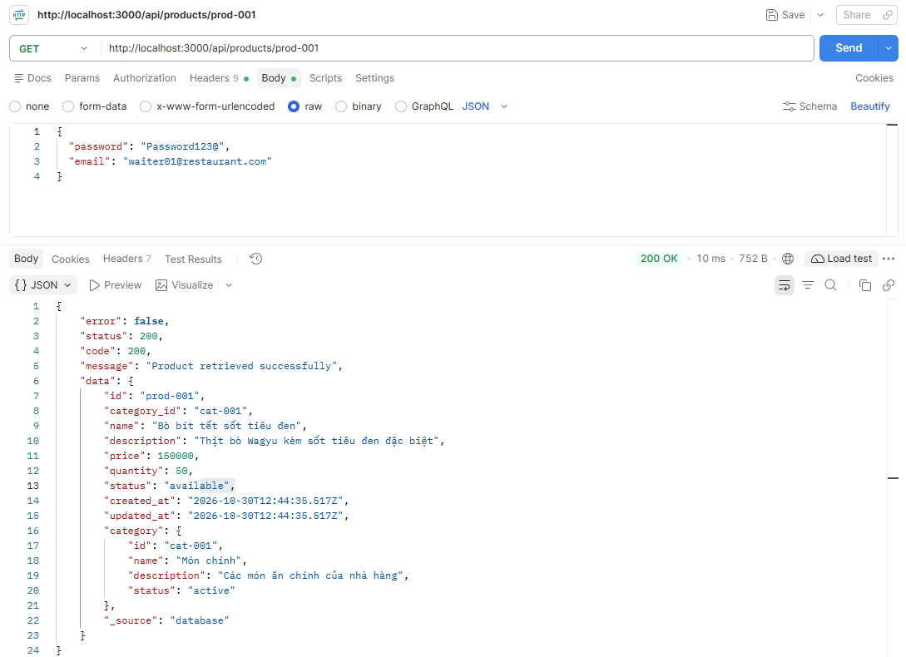
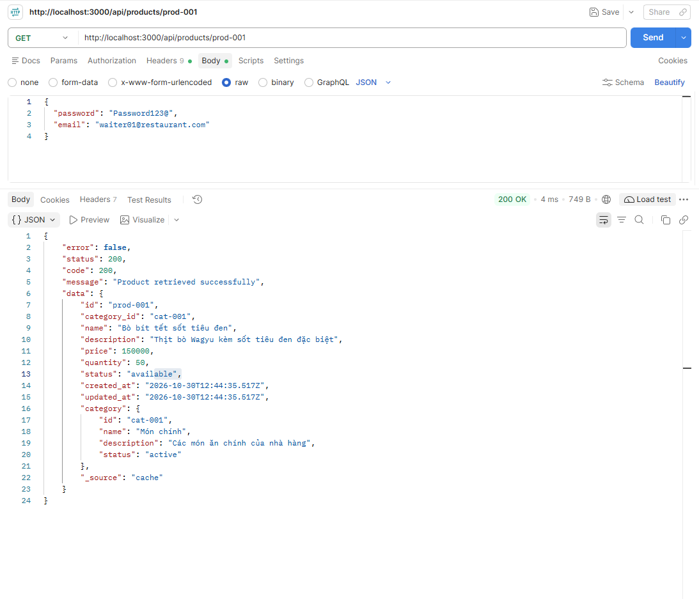

# I. Tìm hiểu về caching

## 1. Khái niệm và lý do cần sử dụng caching

**Caching** là kỹ thuật lưu trữ tạm thời các bản sao của dữ liệu vào một vùng nhớ có tốc độ truy xuất cực nhanh (thường là RAM), giúp các yêu cầu (requests) tiếp theo có thể đọc dữ liệu trực tiếp từ vùng nhớ này thay vì phải truy vấn lại từ nguồn dữ liệu gốc (như ổ cứng HDD/SSD của Database hoặc gọi qua mạng tới một dịch vụ khác).

**Lý do cần sử dụng Caching:**

- **Tăng tốc độ phản hồi (Low Latency):** Truy xuất dữ liệu trên RAM nhanh hơn hàng trăm đến hàng nghìn lần so với đọc từ ổ cứng (Disk I/O). Thời gian phản hồi giảm từ hàng trăm mili-giây (ms) xuống dưới 1–5 ms.

- **Giảm tải cho Database (Database Offloading):** Ngăn chặn tình trạng cơ sở dữ liệu bị quá tải (bottleneck) khi có lượng lớn truy cập đồng thời (High Concurrency) cùng đọc một dữ liệu.

- **Tiết kiệm chi phí hạ tầng:** Giảm nhu cầu phải nâng cấp cấu hình phần cứng (CPU/RAM/IOPS) đắt đỏ cho Database Server.

- **Tăng tính sẵn sàng (High Availability):** Trong một số kiến trúc, nếu Database tạm thời gặp sự cố ngắn hạn, tầng Cache vẫn có thể phục vụ các dữ liệu phổ biến cho người dùng.

## 2. Cache ở đâu? Application-level vs Distributed Cache

Trong một hệ thống backend, dữ liệu có thể được cache tại nhiều tầng (Client, CDN, Reverse Proxy), nhưng ở tầng ứng dụng (Backend), có 2 mô hình chính:

| Tiêu chí | Application-level Cache (In-Memory / Local Cache) | Distributed Cache (Cache phân tán) | 
|----------|---------------------------------------------------|------------------------------------|
| Vị trí lưu trữ | Nằm trực tiếp trong bộ nhớ RAM của chính tiến trình ứng dụng (Application Server) | Nằm trên một hoặc một cụm máy chủ độc lập bên ngoài ứng dụng, giao tiếp qua mạng (TCP/IP)|
| Công nghệ tiêu biểu | Map/Dictionary, Guava Cache, Caffeine (Java), node-cache (Node.js). | Redis, Memcached, Hazelcast |
| Tốc độ truy xuất | Cực nhanh (không tốn chi phí truyền tải qua mạng - Network I/O) | Nhanh (tốn thêm khoảng 0.5ms - 2ms độ trễ mạng nội bộ LAN) | 
| Khả năng đồng bộ (Consistency) | Kém: khi chạy nhiều instance, mỗi server giữ một bản cache riêng dẫn đến lệch dữ liệu giữa các server | Tốt: mọi instance của ứng dụng đều đọc/ghi chung vào một nguồn cache duy nhất |
| Khả năng mở rộng (Scalability) | Giới hạn bởi dung lượng RAM của máy chủ ứng dụng, tốn bộ nhớ trùng lặp trên nhiều server | Dễ dàng mở rộng độc lập (Redis Cluster) lên tới hàng trăm GB mà không ảnh hưởng tới App Server |
| Vòng đời dữ liệu | Mất toàn bộ dữ liệu khi khởi động lại hoặc redeploy ứng dụng | Tồn tại độc lập ngay cả khi ứng dụng khởi động lại hoặc crash |

## 3. Trường hợp sử dụng Cache

**Trường hợp nên sử dụng Cache:**

- Dữ liệu đọc nhiều, ít thay đổi (Read-Heavy, Write-Rarely): Thông tin chi tiết sản phẩm, danh mục hàng hóa, cấu hình hệ thống, bài viết tin tức, hồ sơ người dùng

- Truy vấn tốn tài nguyên: Các câu lệnh SQL phức tạp có nhiều phép JOIN, GROUP BY, thống kê báo cáo hoặc kết quả tính toán nặng

- Dữ liệu chấp nhận độ trễ đồng bộ nhỏ: Số lượt xem(views), bảng xếp hạng, danh sách sản phẩm gợi ý

**Trường hợp không nên sử dụng Cache:**

- Dữ liệu biến động liên tục (Write-Heavy): Giá cổ phiếu khớp lệnh theo ms, tọa độ GPS theo thời gian thực

- Dữ liệu đòi hỏi tính nhất quán tuyệt đối: Số dư tài khoản ngân hàng trong lúc giao dịch chuyển tiền, số lượng tồn kho chính xác ở bước thanh toán cuối cùng

- Dữ liệu quá lớn và hiếm khi được truy cập lại: Nhật ký hệ thống (logs) lịch sử, các truy vấn tìm kiếm đặc thù của từng cá nhân

# II. Chiến lược Caching

## 1. Cache-Aside (Lazy loading)

Là chiến lược phổ biến nhất trong thực tế, Application đóng vai trò trung tâm điều phối giữa Cache và Database (Cache không tự giao tiếp với Database).

**Luồng đọc (Read Flow):**

- Ứng dụng kiểm tra dữ liệu trong Cache

- Nếu có (Cache Hit): Trả dữ liệu ngay lập tức cho Client

- Nếu không có (Cache Miss): Ứng dụng truy vấn dữ liệu từ Database, sau đó lưu bản sao vào Cache (kèm thời gian sống TTL) rồi trả kết quả cho Client

**Luồng ghi (Write Flow):** Ứng dụng cập nhật trực tiếp vào Database, sau đó xóa bản ghi tương ứng trong Cache để lần đọc tiếp theo lấy lại giữ liệu mới

## 2. Write-Through

Mọi thao tác ghi dữ liệu đều phải đi qua Cache và Database đồng thời trước khi xác nhận hoàn tất cho Client

**Luồng ghi (Write Flow):**

- Ứng dụng ghi dữ liệu mới vào Cache

- Dữ liệu được ghi đồng bộ xuống Database ngay trong cùng một luồng xử lý.

- Khi cả 2 nơi thành công, hệ thống mới trả kết quả hoàn tất

**Luồng đọc (Read Flow):** Dữ liệu trong Cache luôn mới nhất nên ứng dụng đọc trực tiếp từ Cache mà hiếm khi gặp Cache Miss

## 3. So sánh Cache-Aside và Write-Through

| Tiêu chí | Cache-Aside | Write-Through |
|----------|-------------|---------------|
| Cơ chế nạp Cache | Chỉ nạp khi có yêu cầu đọc | Nạp ngay lập tức khi có thao tác ghi/cập nhật |
| Tốc độ đọc lần đầu | Chậm (do gặp Cache Miss phải đợi query DB + ghi Cache) | Nhanh (dữ liệu nằm sẵn trong Cache từ lúc ghi) | 
| Tốc độ ghi | Nhanh (chỉ ghi vào DB và xóa key trong Cache) | Chậm hơn (phải đợi ghi thành công cả DB và Cache) |
| Hiệu quả bộ nhớ RAM | Tối ưu: Chỉ những dữ liệu thực sự được người dùng hỏi tới mới chiếm chỗ trong RAM. | Lãng phí RAM: Nhiều dữ liệu ghi vào nhưng không bao giờ được đọc lại vẫn chiếm bộ nhớ Cache. |
| Khi nào nên dùng | Hệ thống đa dụng, tỉ lệ đọc cao hơn ghi, chỉ một phần dữ liệu (hot data) được truy cập thường xuyên. | Hệ thống yêu cầu dữ liệu trong Cache luôn đồng bộ tức thời với DB ngay sau khi cập nhật và không chấp nhận độ trễ ở lần đọc đầu tiên . |

# III. Redis cơ bản

## 1. Khái niệm

Redis (Remote Dictionary Server) là một hệ quản trị cơ sở dữ liệu In-Memory (lưu trữ trên RAM) mã nguồn mở, hoạt động theo cấu trúc Key-Value (NoSQL).

Đặc trưng cốt lõi của Redis:

- Kiến trúc Single-threaded Event Loop: Xử lý các lệnh tuần tự trên một luồng chính kết hợp kỹ thuật I/O Multiplexing, giúp đạt tốc độ hàng trăm nghìn thao tác/giây và đảm bảo tính nguyên tử (Atomic) mà không tốn chi phí quản lý khóa (Locking overhead).

- Hỗ trợ Persistence (Lưu trữ bền vững): Dù chạy trên RAM, Redis vẫn có thể sao lưu dữ liệu xuống ổ cứng thông qua cơ chế RDB (chụp ảnh dữ liệu định kỳ) và AOF (ghi nhật ký từng lệnh thay đổi).

## 2. Các kiểu dữ liệu

| Kiểu dữ liệu | Mô tả cấu trúc | Ứng dụng thực tế | Ví dụ |
|--------------|----------------|------------------|-------|
| String | Chuỗi văn bản, chuỗi JSON tuần tự hóa (serialized) hoặc số nguyên / số thực (tối đa 512MB) | Cache đối tượng JSON, lưu Session token, bộ đến lượt xem | `SET product:1 '{"name":"Pho"}' ` |
| Hash | Bản đồ gồm các cặp field-value gắn với 1 key (tương tự object, dictionary) | Lưu thông tin chi tiết của 1 thực thể (User Profile, Product) giúp cập nhật từng trường lẻ mà không cần ghi đè toàn bộ JSON | `HSET user:101 name "Manh" age 21`|
| List | Danh sách liên kết 2 chiều (Doubly Linked List) các chuỗi, sắp xếp theo thứ tự chèn. | Hàng đợi công việc đơn giản (Message Queue), lưu danh sách bài đăng mới nhất trên Timeline | `LPUSH recent_views "prod:10` |
| Set | Tập hợp các chuỗi không trùng lặp và không có thứ tự, hỗ trợ phép giao, hợp, hiệu | Lưu danh sách IP duy nhất truy cập trong ngày, hệ thống gắn thẻ (Tags), tìm bạn chung trên mạng xã hội | `SADD online_users "user:1" "user:2"` |
| Sorted Set (ZSet) | Tập hợp các phần tử duy nhất nhưng mỗi phần tử gắn kèm một điểm số (Score - số thực tế) để tự động sắp xếp tăng/giảm dần. | Bảng xếp hạng điểm số thời gian thực, hệ thống giới hạn tần suất gọi API | `ZADD leaderboard 1500 "playA"` |

## 3. Các lệnh quản lý cơ bản trên Redis

### 3.1 SET: 

SET dùng để lưu cặp key-value vào Redis

VD: `SET product:100 "BeefSteak"`

### 3.2 GET: 

GET để lấy giá trị của key (trả về nil nếu không tồn tại)

VD: `GET product:100`

### 3.3 EXPIRE

EXPIRE dùng để đặt thời gian sống (TTL) cho key tính bằng giây

VD: đặt thời gian sống cho product 100 là 60s

`EXPIRE product:100 60`

### 3.4 TTL

TTL dùng để kiểm tra thời gian sống còn lại của key (giây).

Trả về >0: số giây còn lại.

Trả về -1: key tồn tại vĩnh viễn (chưa đặt TTL)

Trả về -2: key đã bị xóa, hết hạn

VD: `TTL product:100`

### 3.5 DEL

DEL dùng để xóa key khỏi bộ nhớ ngay lập tức

VD: `DEL product:100`

# IV. Implement

## 1. Use Case: Cache thông tin sản phẩm

Áp dụng Cache-Aside cho lấy chi tiết sản phẩm(getProductById) và Cache Invalidation khi cập nhật/xóa sản phẩm (updateProduct, deleteProduct).

### Luồng xử lý:

Khi gọi GET:

- Ứng dụng kiểm tra key product:{id} trong Redis

- Cache Hit: trả về kết quả ngay lập tức
```javascript
if (cacheData) {
      console.log(`Cache Hit. Lấy dữ liệu product:${id} từ Redis`);
      return {
        ...JSON.parse(cacheData),
        _source: 'cache'
      };
}
```

- Cache Miss: query dữ liệu từ Database, nếu tồn tại thì lưu bản sao vào Redis rồi trả kết quả về cho Client
```java
if (product && redisClient.isOpen) {
    await redisClient.setEx(cacheKey, DEFAULT_TTL, JSON.stringify(product));
}
```

Khi PUT hoặc DELETE:

- Cập nhật hoặc xóa dữ liệu trong Database trước

- Khi Database thành công, xóa dữ liệu trong Redis để tránh trả về dữ liệu cũ
```javascript
if (redisClient.isOpen) {
    await redisClient.del(`product:${id}`);
    console.log(`DELETE cache product:${id} do product đã update`);
}
```
Khi gọi lấy chi tiết sản phẩm lần đầu tiên, dữ liệu chưa có trong cache



Thời gian đọc là 10ms

Khi lấy chi tiết sản phẩm đấy lần thứ 2, dữ liệu đã có trong cache



Thời gian đọc là 4ms

# V. Các vấn đề thường gặp

## 1. TTL nên cài đặt bao lâu

Không có một con số cố định cho mọi loại dữ liệu; thời gian sống của key phụ thuộc vào mức độ biến động và mức độ chấp nhận sai lệch dữ liệu của nghiệp vụ:

- Dữ liệu tĩnh / Danh mục hệ thống (Tỉnh/Thành phố, Danh mục sản phẩm): 24 giờ – 7 ngày

- Thông tin chi tiết sản phẩm, Hồ sơ người dùng (User Profile): 5 phút – 1 giờ (kết hợp chủ động xóa cache khi có cập nhật).

- Phiên đăng nhập (Session / OTP / Rate Limiting): 1 phút – 30 phút theo đúng quy định bảo mật.

- Bảng tin tổng hợp / Trang chủ đông người truy cập: 10 giây – 60 giây.

## 2. Cache Invalidation

Khi dữ liệu gốc trong Database thay đổi (Update/Delete), bản sao trên Redis trở thành dữ liệu cũ (Stale Data).

- Giải pháp chuẩn (Xóa thay vì Cập nhật): Thực hiện Update Database trước Delete Cache sau (DEL key). Không nên dùng lệnh SET đè lại vào Cache khi update vì nếu có 2 luồng cùng cập nhật đồng thời (Race Condition), thứ tự ghi vào DB và Cache có thể bị ngược nhau gây sai lệch vĩnh viễn cho tới khi hết hạn TTL.

- Cơ chế an toàn nâng cao (Delayed Double Delete): Trong hệ thống tải cực cao, áp dụng xóa cache -> cập nhật DB-> đợi 500ms -> xóa cache một lần nữa để triệt tiêu hoàn toàn nguy cơ một luồng đọc cũ vừa kịp nạp lại dữ liệu cũ vào cache.

##  3. Cache Avalanche

**Hiện tượng:** Hàng loạt key trong Redis được khởi tạo cùng lúc với cùng một mức TTL và hết hạn tại cùng một thời điểm (hoặc cụm máy chủ Redis bị sập). Ngay lập tức, toàn bộ lưu lượng truy cập khổng lồ đổ dồn thẳng xuống Database khiến DB quá tải và sập dây chuyền.

**Giải pháp khắc phục:**

- Thêm độ nhiễu ngẫu nhiên vào TTL (TTL Jitter): Thay vì đặt cứng TTL = 3600s cho mọi sản phẩm, cộng thêm một số ngẫu nhiên: TTL = 3600 + random(0, 600) giây để rải đều thời điểm hết hạn.

- Triển khai Redis High Availability: Sử dụng Redis Sentinel hoặc Redis Cluster để tự động chuyển đổi dự phòng (failover) nếu một node Redis bị lỗi.

- Circuit Breaker / Rate Limiting: Giới hạn số lượng request tối đa được phép đi xuống DB khi phát hiện tầng Cache mất kết nối.

## 4. Cache Penetration

**Hiện tượng:** Người dùng (hoặc kẻ tấn công DDoS) liên tục gửi request truy vấn các ID không hề tồn tại trong cả Cache lẫn Database (ví dụ: GET /api/products/-9999 hoặc ID ngẫu nhiên). Do DB không có dữ liệu, ứng dụng không lưu gì vào Cache -> Mọi request tiếp theo đều bị Cache Miss và đâm xuyên thẳng xuống Database, làm cạn kiệt tài nguyên DB.

Giải pháp khắc phục:

- Cache giá trị Null (Null Object Caching): Nếu truy vấn DB không tìm thấy bản ghi, vẫn lưu vào Redis giá trị "NULL" với TTL ngắn (ví dụ: 30 – 60 giây). Các request tiếp theo hỏi cùng ID đó sẽ nhận kết quả rỗng ngay từ Redis.

- Sử dụng Bộ lọc Bloom (Bloom Filter): Đặt một cấu trúc dữ liệu Bloom Filter trên bộ nhớ trước khi gọi Cache/DB. Bloom Filter cho phép kiểm tra cực nhanh với dung lượng bộ nhớ siêu nhỏ xem một ID "chắc chắn không tồn tại" hay "có thể tồn tại", từ đó chặn đứng các ID giả mạo ngay tại cửa ngõ ứng dụng.

- Validate đầu vào nghiêm ngặt: Kiểm tra định dạng ID hợp lệ (số nguyên dương, đúng chuẩn UUID) ngay tại tầng API Controller/Middleware.